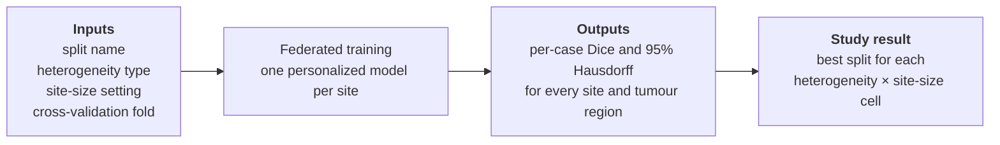
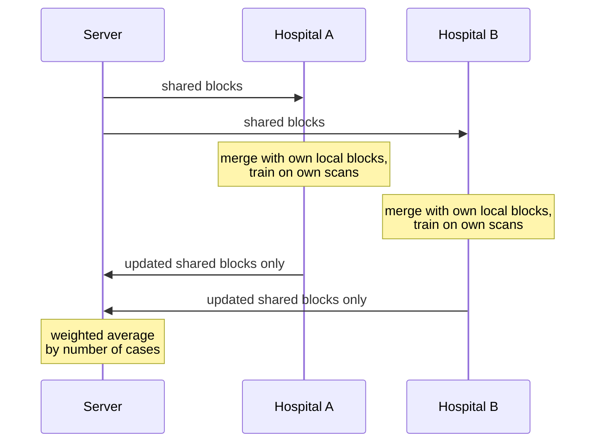

<div align="center">

# Where to Personalize?

**Which parts of a 3D segmentation network should hospitals share, and which should each one keep for itself?**

*A controlled study of split points in personalized federated learning for multimodal brain tumour segmentation.*

</div>

---

## The question in one picture

Hospitals cannot pool patient scans, so they train together by exchanging model weights instead.
Each hospital can keep some layers private so its model fits its own scanners and patients.
Every published method picks one place to cut the network. Nobody has tested all of them.

🟦 shared with every site  🟧 kept local at each site

| Split | stem | enc1 | enc2 | enc3 | bottleneck | dec1 | dec2 | dec3 | dec4 | head | Local weights |
| --- | :-: | :-: | :-: | :-: | :-: | :-: | :-: | :-: | :-: | :-: | --: |
| `fedavg` — share everything | 🟦 | 🟦 | 🟦 | 🟦 | 🟦 | 🟦 | 🟦 | 🟦 | 🟦 | 🟦 | 0% |
| `out_local_1` — local head | 🟦 | 🟦 | 🟦 | 🟦 | 🟦 | 🟦 | 🟦 | 🟦 | 🟦 | 🟧 | <0.1% |
| `decoder_local` — the usual default | 🟦 | 🟦 | 🟦 | 🟦 | 🟦 | 🟧 | 🟧 | 🟧 | 🟧 | 🟧 | 37% |
| `encoder_local` — the reverse | 🟧 | 🟧 | 🟧 | 🟧 | 🟧 | 🟦 | 🟦 | 🟦 | 🟦 | 🟦 | 63% |
| `in_local_1` — local stem | 🟧 | 🟦 | 🟦 | 🟦 | 🟦 | 🟦 | 🟦 | 🟦 | 🟦 | 🟦 | 0.1% |
| `stem_head_local` — shared middle | 🟧 | 🟦 | 🟦 | 🟦 | 🟦 | 🟦 | 🟦 | 🟦 | 🟦 | 🟧 | 0.1% |
| `bottleneck_local` | 🟦 | 🟦 | 🟦 | 🟦 | 🟧 | 🟦 | 🟦 | 🟦 | 🟦 | 🟦 | 47% |
| `local` — no federation | 🟧 | 🟧 | 🟧 | 🟧 | 🟧 | 🟧 | 🟧 | 🟧 | 🟧 | 🟧 | 100% |

The grid has 18 splits in total, including `norm_local` (only normalization layers stay local)
and every intermediate depth from both ends. See [`pflseg/splits.py`](pflseg/splits.py).

## Why this is worth asking

The two closest published results point in opposite directions.

| Setting | Share the early layers | Share the late layers | Source |
| --- | --- | --- | --- |
| Real hospitals, all four MRI sequences present | less harmful | worse | Manthe et al., 2024 |
| Hospitals missing some MRI sequences | 55.4 Dice | **64.8 Dice** | FedMEPD ablation, 2026 |

They used different networks, data and protocols, so the contradiction has never been tested head-on.
This project runs both settings on **one network, one dataset and one protocol**.

**Hypothesis.** The best split depends on *what differs* between hospitals and on *how much data* each one has:

- different scanners and protocols → personalize near the input
- different labelling habits → personalize near the output
- missing MRI sequences → personalize the encoder side
- very few local cases → personalize as little as possible

## Input and output

### Of the model

| | What | Shape |
| --- | --- | --- |
| **Input** | One patient's brain MRI: four co-registered sequences (T1, contrast-enhanced T1, T2, FLAIR), cropped to a patch | `4 × 128 × 128 × 128` |
| **Output** | Three overlapping tumour-region masks: whole tumour, tumour core, enhancing tumour | `3 × 128 × 128 × 128` |

The network is a 3D U-Net (MONAI `DynUNet`, 22.6M parameters, five resolution levels from 32 to 512 channels),
the same architecture as the reference benchmark by Manthe et al.
Whole volumes are segmented by sliding the patch window across the scan.

### Of one experiment



### Of the whole study

1. **A map** from heterogeneity type and site size to the best split, with paired significance tests.
2. **A diagnostic**: a cheap score computed after one epoch that predicts the best split without running the grid.
3. **A verdict** on whether partial sharing ever beats plain federated averaging followed by local fine-tuning.

## How a training round works



Local blocks never leave the hospital. Scans never leave the hospital.

## Data

| Dataset | Cases | Sites | Role | Access |
| --- | --: | --: | --- | --- |
| **FeTS 2022** (the BraTS 2021 training cases with their originating institutions) | 1,251 | 23 | Main dataset | [Register and request on Synapse](https://www.synapse.org/Synapse:syn54079892/wiki/626845) |
| **MSD Task01 Brain Tumour** | 484 | none recorded | Pipeline development, missing-sequence experiments | Public, fetched by `get_data.sh` |

Each case is a 3D brain MRI with four sequences and an expert tumour annotation.

The real hospital sizes in FeTS 2022 are extremely uneven, and that is part of the problem being studied:

```
cases per institution
511 ████████████████████████████████████████████████████
382 ██████████████████████████████████████
 47 █████
 35 ████
 35 ████
 34 ███
 33 ███
 30 ███
 22 ██
 15 █▌   and 13 more institutions with 14 down to 4 cases
```

### The three experimental factors

| Factor | Levels |
| --- | --- |
| **Split point** | 18 splits, from share-everything to share-nothing |
| **Heterogeneity** | real site shift · simulated missing MRI sequences · both |
| **Site size** | about 20, 35, 100 and 300 training cases, by subsampling the two large institutions |

Evaluation follows Manthe et al.: five-fold federated cross-validation with folds drawn inside each site,
per-case metrics, and paired Wilcoxon tests.

## Status

| Component | State |
| --- | --- |
| Network, block naming, 18 split specifications | ✅ done, unit-tested |
| Federated averaging over shared blocks only | ✅ done, unit-tested |
| Institution partitions and cross-validation folds | ✅ in `partitions/` |
| Data pipeline and preprocessing | ⬜ next |
| Training loop and baselines | ⬜ |
| Missing-sequence and site-size generators | ⬜ |
| Pilot grid, diagnostic, statistics | ⬜ |

**No experimental results exist yet.** The numbers in this README come from the cited papers.

## Quick start

```bash
pip install -r requirements.txt
```

```bash
python -m pytest -q tests
```

```bash
bash get_data.sh ./data
```

```python
from pflseg.model import build_unet
from pflseg.splits import all_splits

net = build_unet()                         # 4 MRI sequences in, 3 tumour regions out
split = all_splits()["encoder_local"]
names = [n for n, _ in net.named_parameters()]
print(len(split.shared_names(names)), "tensors shared,",
      len(split.local_names(names)), "kept local")
```

## Repository layout

```
pflseg/
  model.py     3D U-Net and the mapping from parameters to ten named blocks
  splits.py    the grid of splits
  fed.py       weighted averaging restricted to shared parameters
tests/         unit tests for all of the above
partitions/
  fets2022/        institution partitions from the FeTS challenge
  manthe_folds/    five-fold federated cross-validation folds
  fedmepd_brats/   BraTS 2018 and 2020 client splits from FedMEPD
get_data.sh    downloads the public dataset, documents the gated one
```

## Background reading

- Manthe, Duffner, Lartizien. [Federated brain tumor segmentation: an extensive benchmark](https://arxiv.org/abs/2410.17265). Medical Image Analysis, 2024.
- Liu et al. [Federated Modality-specific Encoders and Partially Personalized Fusion Decoder (FedMEPD)](https://arxiv.org/abs/2603.04887). 2026.
- Elhussein, Pollet, Gürsoy. [PLayer-FL: A Principled Approach to Personalized Layer-wise Cross-Silo Federated Learning](https://arxiv.org/abs/2502.08829). MLSys 2026.
- Zhu et al. [FL-MedSegBench](https://arxiv.org/abs/2603.11659). 2026.
- Pillutla et al. [Federated Learning with Partial Model Personalization](https://arxiv.org/abs/2204.03809). ICML 2022.

The partition files in `partitions/` come from
[FeTS-AI/Challenge](https://github.com/FeTS-AI/Challenge),
[MatthisManthe/Benchmark_FeTS2022](https://github.com/MatthisManthe/Benchmark_FeTS2022) and
[ccarliu/FedMEPD](https://github.com/ccarliu/FedMEPD), and belong to their authors.
