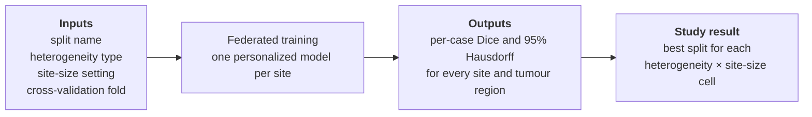
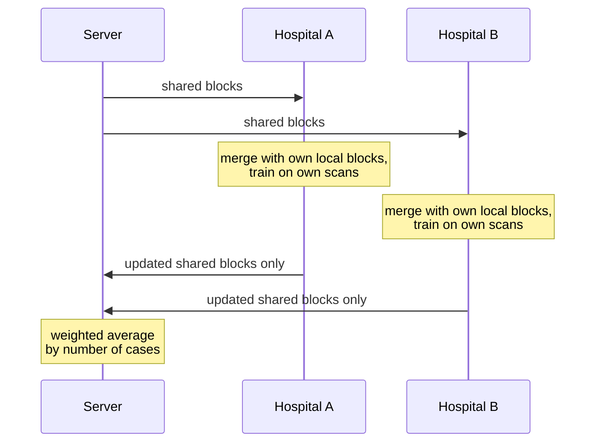

<div align="center">

# Where to Personalize?

**Which parts of a 3D segmentation network should hospitals share, and which should each one keep for itself?**

*A controlled study of split points in personalized federated learning for multimodal brain tumour segmentation.*

</div>

---

## The question in one picture

Hospitals cannot pool patient scans, so they train together by exchanging model weights instead.
Each hospital can keep some layers private so its model fits its own scanners and patients.
Every published method picks one place to cut the network. Nobody has tested all of them.

🟦 shared with every site  🟧 kept local at each site

| Split | stem | enc1 | enc2 | enc3 | bottleneck | dec1 | dec2 | dec3 | dec4 | head | Local weights |
| --- | :-: | :-: | :-: | :-: | :-: | :-: | :-: | :-: | :-: | :-: | --: |
| `fedavg` — share everything | 🟦 | 🟦 | 🟦 | 🟦 | 🟦 | 🟦 | 🟦 | 🟦 | 🟦 | 🟦 | 0% |
| `out_local_1` — local head | 🟦 | 🟦 | 🟦 | 🟦 | 🟦 | 🟦 | 🟦 | 🟦 | 🟦 | 🟧 | <0.1% |
| `decoder_local` — the usual default | 🟦 | 🟦 | 🟦 | 🟦 | 🟦 | 🟧 | 🟧 | 🟧 | 🟧 | 🟧 | 37% |
| `encoder_local` — the reverse | 🟧 | 🟧 | 🟧 | 🟧 | 🟧 | 🟦 | 🟦 | 🟦 | 🟦 | 🟦 | 63% |
| `in_local_1` — local stem | 🟧 | 🟦 | 🟦 | 🟦 | 🟦 | 🟦 | 🟦 | 🟦 | 🟦 | 🟦 | 0.1% |
| `stem_head_local` — shared middle | 🟧 | 🟦 | 🟦 | 🟦 | 🟦 | 🟦 | 🟦 | 🟦 | 🟦 | 🟧 | 0.1% |
| `bottleneck_local` | 🟦 | 🟦 | 🟦 | 🟦 | 🟧 | 🟦 | 🟦 | 🟦 | 🟦 | 🟦 | 47% |
| `local` — no federation | 🟧 | 🟧 | 🟧 | 🟧 | 🟧 | 🟧 | 🟧 | 🟧 | 🟧 | 🟧 | 100% |

The grid has 18 splits in total, including `norm_local` (only normalization layers stay local)
and every intermediate depth from both ends. See [`pflseg/splits.py`](pflseg/splits.py).

## Why this is worth asking

The two closest published results point in opposite directions.

| Setting | Share the early layers | Share the late layers | Source |
| --- | --- | --- | --- |
| Real hospitals, all four MRI sequences present | less harmful | worse | Manthe et al., 2024 |
| Hospitals missing some MRI sequences | 55.4 Dice | **64.8 Dice** | FedMEPD ablation, 2026 |

They used different networks, data and protocols, so the contradiction has never been tested head-on.
This project runs both settings on **one network, one dataset and one protocol**.

**Hypothesis.** The best split depends on *what differs* between hospitals and on *how much data* each one has:

- different scanners and protocols → personalize near the input
- different labelling habits → personalize near the output
- missing MRI sequences → personalize the encoder side
- very few local cases → personalize as little as possible

## Input and output

### Of the model

| | What | Shape |
| --- | --- | --- |
| **Input** | One patient's brain MRI: four co-registered sequences (T1, contrast-enhanced T1, T2, FLAIR), cropped to a patch | `4 × 128 × 128 × 128` |
| **Output** | Three overlapping tumour-region masks: whole tumour, tumour core, enhancing tumour | `3 × 128 × 128 × 128` |

The network is a 3D U-Net (MONAI `DynUNet`, 22.6M parameters, five resolution levels from 32 to 512 channels),
the same architecture as the reference benchmark by Manthe et al.
Whole volumes are segmented by sliding the patch window across the scan.

### Of one experiment



### Of the whole study

1. **A map** from heterogeneity type and site size to the best split, with paired significance tests.
2. **A diagnostic**: a cheap score computed after one epoch that predicts the best split without running the grid.
3. **A verdict** on whether partial sharing ever beats plain federated averaging followed by local fine-tuning.

## How a training round works



Local blocks never leave the hospital. Scans never leave the hospital.

## Data

| Dataset | Cases | Sites | Role | Access |
| --- | --: | --: | --- | --- |
| **FeTS 2022** (the BraTS 2021 training cases with their originating institutions) | 1,251 | 23 | Main dataset | [Register and request on Synapse](https://www.synapse.org/Synapse:syn54079892/wiki/626845) |
| **MSD Task01 Brain Tumour** | 484 | none recorded | Pipeline development, missing-sequence experiments | Public, fetched by `get_data.sh` |

Each case is a 3D brain MRI with four sequences and an expert tumour annotation.

The real hospital sizes in FeTS 2022 are extremely uneven, and that is part of the problem being studied:

```
cases per institution
511 ████████████████████████████████████████████████████
382 ██████████████████████████████████████
 47 █████
 35 ████
 35 ████
 34 ███
 33 ███
 30 ███
 22 ██
 15 █▌   and 13 more institutions with 14 down to 4 cases
```

### The three experimental factors

| Factor | Levels |
| --- | --- |
| **Split point** | 18 splits, from share-everything to share-nothing |
| **Heterogeneity** | real site shift · simulated missing MRI sequences · both |
| **Site size** | about 20, 35, 100 and 300 training cases, by subsampling the two large institutions |

Evaluation follows Manthe et al.: five-fold federated cross-validation with folds drawn inside each site,
per-case metrics, and paired Wilcoxon tests.

## Status

| Component | State |
| --- | --- |
| Network, block naming, 18 split specifications | ✅ unit-tested |
| Federated averaging over shared blocks only | ✅ unit-tested |
| Preprocessing (crop, z-score, pad), clients, folds, missing sequences | ✅ unit-tested, checked on real MSD scans |
| Training, validation-based model selection, local fine-tuning, resume | ✅ end-to-end tested on CPU |
| Per-case Dice and HD95, results tables with paired tests | ✅ tested |
| Pilot grid on FeTS 2022 | ⬜ ready to submit |
| Early-epoch diagnostic | ⬜ after the pilot |

**No experimental results exist yet.** The numbers in this README come from the cited papers.

## Run it on HiPerGator

Once, from `/blue/<group>/$USER`:

```bash
git clone https://github.com/ishaan1234/fedtry && cd fedtry
```

```bash
module load python && python -m venv env && source env/bin/activate
```

```bash
pip install torch --index-url https://download.pytorch.org/whl/cu128 && pip install -r requirements.txt
```

Then the whole study is one command: it downloads FeTS 2022 (if not already there),
preprocesses it, and submits the training grid as a job array.

```bash
export SYNAPSE_AUTH_TOKEN='<view+download token>' && bash run_all.sh
```

When the training jobs finish (partial results work too):

```bash
python scripts/analyze.py
```

`results/summary.md` then holds one table per heterogeneity setting: Dice per region, HD95,
per-site and worst-site Dice, and a Holm-corrected paired Wilcoxon test against FedAvg with
local fine-tuning.

| Option | Default | Meaning |
| --- | --- | --- |
| `GRID` | `experiments/pilot.txt` | 30 runs: 10 methods × 3 settings, fold 0. `experiments/full.txt` has 285 runs: 19 methods × 3 settings × 5 folds |
| `MAXPAR` | `3` | B200 jobs running at once |
| `CPUS`, `MEM` | `4`, `32gb` | per job; with `MAXPAR=3` this is about 40% of the group quota |
| `AFTER` | none | job ID to wait for before starting |
| `ARRAY` | all lines | grid lines to submit, e.g. `2-29` |

### Results go to GitHub automatically

Every job pushes its log, and training jobs push their run files (config, logs, per-case scores)
into `results/` every 2 hours and when they end, including after a crash. Images, preprocessed
data and checkpoints never leave HiPerGator. This needs push access from HiPerGator, once:

```bash
ssh-keygen -t ed25519 -N "" -f ~/.ssh/fedtry_deploy && cat ~/.ssh/fedtry_deploy.pub
```

Paste the printed key at https://github.com/ishaan1234/fedtry/settings/keys/new and tick
**Allow write access**. Then:

```bash
printf 'Host github.com\n  IdentityFile ~/.ssh/fedtry_deploy\n' >> ~/.ssh/config && git remote set-url origin git@github.com:ishaan1234/fedtry.git && ssh -T git@github.com
```

If compute nodes cannot reach GitHub, results stay committed in the clone; push them from the
login node with `bash scripts/push_results.sh`.

Finished runs are skipped and interrupted runs resume from a checkpoint,
so resubmitting `run_all.sh` after a time-out or failure is always safe.
Edit the `#SBATCH` lines in `scripts/` if your account or partition differ.

### One run by hand

```bash
python -m pflseg.train --data_dir data/fets2022_prep \
  --partition partitions/fets2022/partitioning_1.csv \
  --split decoder_local --het site_modality --fold 0
```

Writes `runs/<name>/`: `config.json` (sites, case counts, sequences held), `train_log.csv`,
`val_log.csv`, `test_cases.csv` (per case and region) and `summary.json`.

| Setting (`--het`) | Sites | MRI sequences |
| --- | --- | --- |
| `site` | 23 real institutions | all four everywhere |
| `modality` | same sizes, cases dealt at random | each site holds 4, 3, 2 or 1 |
| `site_modality` | 23 real institutions | each site holds 4, 3, 2 or 1 |

Training follows Manthe et al.: 300 rounds of one local epoch, SGD (lr 0.01, ×0.995 per round),
batch 4, 128³ patches, Dice + cross-entropy loss, validation every 10 rounds. Each site keeps the
round where its own validation Dice was best; `+ft` runs then fine-tune locally for 30 epochs.

## Repository layout

```
pflseg/
  model.py      3D U-Net and the mapping from parameters to ten named blocks
  splits.py     the grid of splits
  fed.py        weighted averaging restricted to shared parameters
  data.py       clients, folds, missing-sequence assignment, patch loading, augmentation
  evaluate.py   sliding-window prediction, Dice, HD95
  train.py      one run: federated training, model selection, fine-tuning, testing
scripts/
  prepare_fets.py   NIfTI -> cropped, normalized arrays
  analyze.py        runs/ -> results/summary.md and CSV tables
  hpg_*.sbatch      SLURM jobs: download, preprocess, training array
experiments/    grid files, one run per line
run_all.sh      submits the whole pipeline with job dependencies
get_data.sh     downloads FeTS 2022 (token) and optionally MSD Task01
tests/          unit and end-to-end tests
partitions/
  fets2022/        institution partitions from the FeTS challenge
  manthe_folds/    five-fold federated cross-validation folds
  fedmepd_brats/   BraTS 2018 and 2020 client splits from FedMEPD
```

## Background reading

- Manthe, Duffner, Lartizien. [Federated brain tumor segmentation: an extensive benchmark](https://arxiv.org/abs/2410.17265). Medical Image Analysis, 2024.
- Liu et al. [Federated Modality-specific Encoders and Partially Personalized Fusion Decoder (FedMEPD)](https://arxiv.org/abs/2603.04887). 2026.
- Elhussein, Pollet, Gürsoy. [PLayer-FL: A Principled Approach to Personalized Layer-wise Cross-Silo Federated Learning](https://arxiv.org/abs/2502.08829). MLSys 2026.
- Zhu et al. [FL-MedSegBench](https://arxiv.org/abs/2603.11659). 2026.
- Pillutla et al. [Federated Learning with Partial Model Personalization](https://arxiv.org/abs/2204.03809). ICML 2022.

The partition files in `partitions/` come from
[FeTS-AI/Challenge](https://github.com/FeTS-AI/Challenge),
[MatthisManthe/Benchmark_FeTS2022](https://github.com/MatthisManthe/Benchmark_FeTS2022) and
[ccarliu/FedMEPD](https://github.com/ccarliu/FedMEPD), and belong to their authors.
